  

  

  
  
  

## `[ 01 ]` Sobre mí

Soy **Gabo**, desarrollador **front-end y Android** de Buenos Aires. Trabajé **2 años y 8 meses** en producción con **React, TypeScript y Vue 2**, y estoy cerrando la **Tecnicatura en Desarrollo de Aplicaciones Móviles** en la UNLaM, donde me metí de lleno en **Kotlin, Jetpack Compose** y arquitectura.

Me obsesiona el detalle que nadie nota, me gusta romper cosas para entender cómo funcionan y creo que el feedback claro es lo que hace despegar un proyecto.

> 💼 Mi trabajo en DIGICARD vive en el GitLab de la empresa, así que no aparece en los commits de este perfil.

## `[ 02 ]` Ahora mismo

- 🎵 **[Melodya](https://github.com/melodya-org)**: una idea se vuelve canción. Desarrollo el **cliente Android** (Kotlin, Jetpack Compose, Clean Architecture, corrutinas y Flow, CI con lint y tests). Proyecto final de la tecnicatura.
- 🎓 Cerrando la tecnicatura en la UNLaM.
- 🧪 Kotlin Multiplatform y React Native los fines de semana, para tener el combo nativo, web e híbrido.

## `[ 03 ]` Experiencia

### Desarrollador Web Front-end · **DIGICARD**
`Full time · Remoto · Ene 2024 — Ago 2026`

Apps en **Vue 2** y **React** con Clean Architecture y MVC, en equipos con despliegue a producción y GitLab. Varios proyectos en paralelo.

<b>⏱️ DS9 DTA: tiempo y asistencia</b> · Vue 2 · Vuetify · Vuex · Node.js

 

Control de presentismo y liquidación de horas con un motor de cálculo en tiempo real, más los módulos Workflow, Comedor (DCO) y Self Service (DSS).

- Interfaces responsivas en Vue 2 + Vuetify y componentes reutilizables para todo el equipo.
- APIs REST contra el motor de cálculo de horas; estado global con Vuex y persistencia local.
- **Proxy en Node.js/Express** para integrar biométricos Suprema (huella y rostro), porque BioStar 2 no se podía adaptar a una web moderna.

<b>📡 SkySync: monitoreo de dispositivos</b> · React · TypeScript · Zustand · MQTT · PWA

 

Monitoreo y control centralizado de dispositivos HID Amico y servicios por empresa.

- React + TypeScript con Zustand, y Clean Architecture con mappers y DTOs.
- REST propio + **eventos MQTT** para sincronizar dispositivos en tiempo real, con un polling de cargados contra activos y monitor de eventos.
- Jerarquía y niveles de usuario, y soporte **PWA** para usarla desde el celular.

<b>🔍 App Divi: auditoría UI/UX y QA exploratorio</b> · React Native · Expo

 

- Testing de caja negra funcional y de UI para los dos roles (Visitado y Visitante).
- Detección de crashes y validación de la lógica de calendario y turnos.
- Propuestas de diseño e interacción para mejorar el flujo de reserva.

## `[ 04 ]` Stack

**Mobile**

  

  
  
  
  
  
  
  

**Web**

  

  
  
  
  

**Backend, datos y herramientas**

  

  
  
  

**Arquitectura**

  
  
  
  

## `[ 05 ]` Proyectos

| | Proyecto | Qué hace | Stack |
|---|---|---|---|
| 🎵 | [**Melodya**](https://github.com/melodya-org) | Una idea se vuelve canción. Cliente Android del proyecto final. | Kotlin · Compose · Clean Architecture |
| 🐾 | [**Paw Finder**](https://github.com/Gaburiiru/PawFinder) | Mascotas perdidas con mapa, geolocalización, cámara y Firebase. | Kotlin · Compose · Material 3 · Google Maps |
| 💸 | **Cuida tu Bolsillo** | Finanzas personales con persistencia local, API externa y gráficos. | Kotlin · Compose |
| 🎮 | **Games Break** | CRUD de juegos con RecyclerView y librerías externas. | Java · XML · Fragments |
| 🗺️ | [**API Mapa**](https://github.com/Gaburiiru/API-OpenStreetMaps) | Buscador de destinos sobre OpenStreetMap con marcadores propios. | React · Leaflet · Tailwind |
| 🌦️ | [**API Clima**](https://github.com/Gaburiiru/api-react-clima) | Clima por ciudad, historial persistido y modo oscuro. | React · Context API · Tailwind |
| 🛒 | [**API Tienda**](https://github.com/Gaburiiru/API-Tienda-React) | Catálogo con búsqueda, carrito y estado global. | React · Redux · Tailwind |

## `[ 06 ]` Formación

| | | |
|---|---|---|
| 🎓 | **Tecnicatura en Desarrollo de Aplicaciones Móviles** · UNLaM | `2021 — hoy` |
| 📜 | **Diplomatura en Desarrollo Web** · Centro Universitario de la Innovación | `2021 — 2022` |

## `[ 07 ]` Fuera del código

🎸 Músico: grabo covers instrumentales y a veces compongo algo propio (por eso Melodya me toca de cerca).
🎮 Gamer: de AAA a battle royales, y algún souls-like para sufrir por diversión.
🎧 En loop: jazz, soul, R&B, rock, punk, reggae, lo-fi y hip-hop.

  

